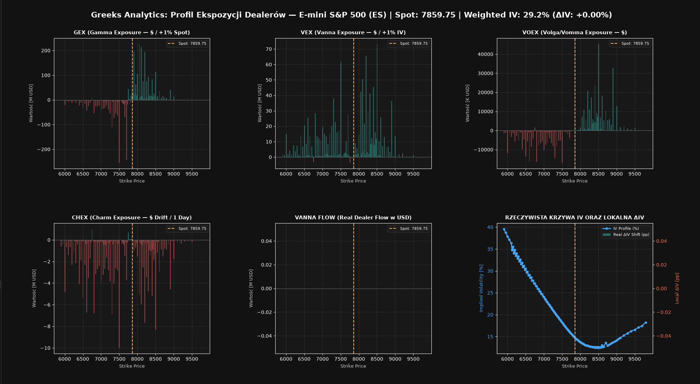

# Greeks Analytics — Options Microstructure & Dealer Exposure Engine


**Greeks Analytics** is an options microstructure analysis and dealer-exposure engine for commodity and index futures. It retrieves Barchart options and futures data, calculates Black-76 prices and Greeks, and presents exposure profiles for Coffee, Sugar, Cocoa, Crude Oil, and E-mini S&P 500 futures.



## Key Features

- **Live market data:** Playwright-based scrapers retrieve options-chain and futures-history data.
- **Black-76 analytics:** Calculate Delta, Gamma, Vanna, Vomma/Volga, Charm, and implied volatility for futures options.
- **Dealer exposure profiles:** Calculate GEX, VEX, VOEX, CHEX, and Vanna Flow using contract-specific multipliers.
- **Multiple markets:** Contract specifications and ticker routing support `KC`, `SB`, `CC`, `CL`, and `ES`.
- **Responsive dashboard:** Matplotlib displays a symmetric 2 × 3 dashboard in dark mode. Strike-based `bar_width` is derived from the smallest positive gap between strikes, so bars adapt to dense and sparse option chains.
- **Persistent IV state:** Per-ticker `iv_state_{ticker}.json` files in `data/` support local IV-change calculations between cycles.

## Project Structure

```text
BarchartScrapper/
├── .github/
│   └── agents/
│       ├── architect-agent.agent.md
│       ├── math-auditor.agent.md
│       ├── python-test-agent.agent.md
│       ├── quant-engineer.agent.md
│       ├── readme-updater.agent.md
│       └── ui-ux-agent.agent.md
├── data/                       # Per-ticker JSON/CSV data and iv_state_{ticker}.json
├── dashboards/                 # Saved {ticker}_exposures_dashboard.png images
├── tests/
│   ├── e2e/                    # Pipeline and multi-cycle tests
│   ├── unit/                   # Pricing, exposure, routing, and visualization tests
│   └── conftest.py             # Shared pytest fixtures
├── black76.py                  # Black-76 pricing and Greeks
├── contract_specs.py           # Supported ticker and contract specifications
├── exposure_engine.py          # GEX, VEX, VOEX, CHEX, and Vanna Flow calculations
├── futures_parser.py           # Futures JSON parser
├── futures_scraper.py          # Futures-history scraper
├── options_parser.py           # Generic options JSON parser
├── options_scraper.py          # Options-chain scraper
├── run_pipeline.py             # CLI and continuous live pipeline
├── visualize_exposures.py      # Matplotlib 2 × 3 exposure dashboard
└── pytest.ini                  # Pytest configuration
```

Scraped data and generated dashboards are stored under `data/` and `dashboards/`, respectively. Example filenames include `kc_options.json`, `kc_options.csv`, `kc_futures.json`, `kc_futures.csv`, `iv_state_KC.json`, and `kc_exposures_dashboard.png`.

## Quick Start

Create and activate a virtual environment, install the project dependencies (`pandas`, `numpy`, `matplotlib`, `playwright`, and `pytest`), and install the Chromium browser used by Playwright:

```bash
python -m venv .venv

# Windows PowerShell
.\.venv\Scripts\Activate.ps1

# Linux/macOS
source .venv/bin/activate

pip install pandas numpy matplotlib playwright pytest
playwright install chromium
```

### Running the application

Run `run_pipeline.py` for the default Coffee market (`KC`), or select a
supported market with `--ticker`:

```bash
# Coffee (default)
python run_pipeline.py
python run_pipeline.py --ticker KC

# Sugar
python run_pipeline.py --ticker SB

# Cocoa
python run_pipeline.py --ticker CC

# Crude Oil
python run_pipeline.py --ticker CL

# S&P 500 futures
python run_pipeline.py --ticker ES
```

The default market is `KC` (Coffee). Ticker values are case-insensitive, so
`--ticker cl` and `--ticker CL` select the same market. The application runs a
continuous refresh loop that retrieves market data every 15 minutes. It saves
the options and futures JSON files under `data/` (for example,
`data/cl_options.json` and `data/cl_futures.json`) and writes the dashboard
image under `dashboards/` (for example,
`dashboards/cl_exposures_dashboard.png`). Press `Ctrl+C` to stop the loop.

## AI Agent Team

The repository's custom agents are defined in `.github/agents/`:

| Agent | Role |
| :--- | :--- |
| `@python-test-agent` | Automates unit and end-to-end testing with `pytest`. |
| `@quant-engineer` | Black-76 pricing, Greeks, and exposure engine (GEX, VEX, VOEX, CHEX). |
| `@math-auditor` | Audits mathematical formulas and analytical derivatives using finite differences. |
| `@architect-agent` | Multi-market architecture (`--ticker`) and `data/` / `dashboards/` directory structure. |
| `@ui-ux-agent` | Matplotlib chart responsiveness, dynamic `bar_width`, and dark theme. |
| `@readme-updater` | Keeps `README.md` synchronized with the source code. |

## Dashboard

The dashboard uses a symmetric 2 × 3 layout:

1. GEX — Gamma Exposure
2. VEX — Vanna Exposure
3. VOEX — Vomma/Volga Exposure
4. CHEX — Charm Exposure
5. Vanna Flow
6. Implied-volatility curve with local ΔIV

Bar widths are calculated from the strike spacing rather than using a fixed width, with a fallback for a single available strike. Dashboard images are saved as `dashboards/{ticker}_exposures_dashboard.png` (ticker in lowercase).

## Tests

Run the complete test suite from the repository root:

```bash
pytest
```

The latest project test status is **37 passed**.

## License

Distributed under the MIT License.
